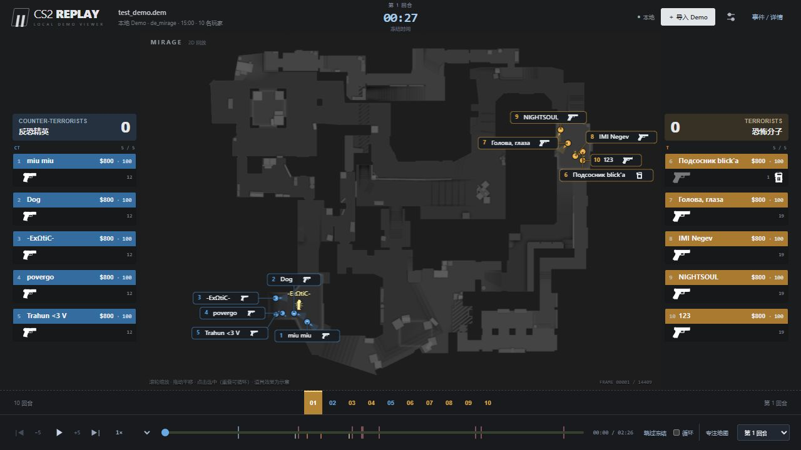

# CS2 Replay — 本地 2D Demo 查看器

将 CS2 `.dem` 比赛录像导入浏览器，在可缩放的雷达地图上复盘玩家站位、道具投掷与生效、整回合交锋和装备状态。基于 [demoinfocs-golang v5.2.0](https://github.com/markus-wa/demoinfocs-golang/releases/tag/v5.2.0)，网页、地图和解析器均在本机运行，不需要账号、CS2 客户端、REA 或云端服务。



## 启动

Windows：安装 [Go 1.24 或更高版本](https://go.dev/dl/)，下载或克隆源码后双击 **`Start Viewer.cmd`**。首次启动会编译本地程序，然后打开默认浏览器。也可以先运行 `build.ps1` 编译。

默认地址：<http://127.0.0.1:8765>。保持终端窗口开启；使用 **Ctrl+C** 停止服务。再次启动会复用同端口已经运行的查看器。

源码仓库不包含 `bin/` 中的生成文件。编译一次后，日常播放不需要 Go 或 Node.js，可直接运行：

```powershell
.\bin\cs2-viewer.exe -open
# 端口被其他程序占用时：
.\bin\cs2-viewer.exe -port 8766 -open
```

## 使用

1. 点击 **导入 Demo** 或将一个 `.dem` 文件拖进页面。`.zip` / `.bz2` 请先解压。
2. 等待本地解析完成，地图上显示双方玩家位置。
3. 点击播放按钮，或按 **空格** 播放 / 暂停。
4. 选择 **0.25×、0.5×、1×、2×、4×、8×** 倍速。
5. 拖动全场或**本回合进度**跳转；**← / →** 前后移动 5 秒。
6. 点击底部回合条直接切换回合，也可从下拉菜单选择或用上一回合 / 下一回合按钮切换。
7. 使用**跳过冻结**进入回合交战阶段；勾选**循环本回合**反复观察同一段攻防。
8. 在地图上滚轮缩放、拖拽平移，或使用 **− / ＋** 按钮。点击缩放百分比复位；**专注地图**收起侧栏，扩大地图区域。
9. 从地图设置调整**人物大小**；点击地图玩家或两侧队员名单查看装备和个人道具。多人靠近时先放大地图，再用名称和高亮定位各自的真实站位。
10. 地图设置可分别开关名称、当前手持装备图标、开火特效、近 3 秒移动轨迹、道具、抛物线、爆点 / 范围与击杀连线。多层地图可手动切换底图，另一层玩家会淡化显示。

网页里的“体验示例”是**人工合成数据**，仅用于熟悉操作。它包含 3 回合、每回合 5 次击杀，以及烟雾弹、闪光弹、高爆手雷、燃烧弹和诱饵弹；第一回合 7–11 秒演示燃烧，11 秒烟雾生效并灭火，方便检查前后拖动。玩家路线、轨迹、火焰位置均非真实比赛数据。正式复盘请导入自己的 Demo。

## 回合、道具与玩家复盘

- **回合复盘**保留本回合全部击杀，不再只显示最后四条。尚未发生的事件淡化显示；点击事件可跳转查看。记录包括双方玩家、武器、爆头，以及 Demo 提供的助攻、穿烟、穿墙、盲狙等信息。
- **道具**标签页显示投掷者、道具类型、投出与生效时间，关联地图上的轨迹和爆点。可用类型筛选聚焦烟、闪、雷、火或诱饵；地图和本回合时间轴帮助比较道具与交锋的先后顺序。
- **玩家详情**与队员名单展示血量、护甲、头盔、拆包钳、当前武器、弹药、金钱及剩余道具；闪白、开镜、蹲下等状态来自录像数据。投掷后库存随时间更新。
- **观战布局**将地图放在中央、双方队员放在两侧、回合与控制放到底部。两侧显示主副武器、当前装备高亮、护甲与道具剪影；地图玩家上方显示正在手持的武器，死亡后在实际死亡位置保留灰色姓名与叉号。队伍有记录时显示实际队名。
- **开火特效**依据 Demo 中逐次 `WeaponFire` 的时刻、坐标和朝向绘制枪口火光；使用枪械事件独立记录，不会把手雷投掷或挥刀显示成开枪。高倍速时短暂特效可能跨帧跳过。
- **道具特效**区分烟团与剩余时间弧、火焰、闪光星芒、高爆爆炸和诱饵声波；飞行中的投掷物显示真实装备剪影。所有图标离线打包，来源与许可见 [ICON_SOURCES.md](ICON_SOURCES.md)。
- 道具飞行时显示路径，落地后收起旧轨迹以保持地图清晰；点击道具或在复盘列表定位，可重新查看完整投掷路径与反弹点。
- 地图缩放保持真实位置坐标，不会为了避开重叠而挪动玩家位置。标记大小可独立调整，名称标签与选中高亮用于辨认密集站位。
- **密集站位**中，姓名、编号与手持枪械作为一个整体标签避让，带引线连接实际坐标；标签不会因候选位置用完而直接消失，并尽量沿用上一帧位置避免跳动。标签编号对应左右队员名单，悬停或点击可高亮真实位置。多人靠近时只缩小圆点外观，坐标、相互距离和朝向不变；位置完全重合时可以逐个选择标签，并用滚轮放大查看。

交互功能参考 Noesis 的公开说明：[道具列表、投掷者与事件跳转](https://www.noesis.gg/news/20190129-grenades.html)、[CS2 道具轨迹与烟雾灭火](https://www.noesis.gg/news/october-2023-changelog.html)。第三版布局与表现参考用户提供的 [TGPRO Demo Viewer](https://tgpro.net/demo-viewer) 截图，未使用其专有素材或服务。

## 地图与显示范围

内置 Mirage、Inferno、Dust II、Nuke、Ancient、Anubis、Vertigo、Overpass、Train 九张地图，包含 Nuke / Vertigo / Train 下层图片。地图图片及坐标来自同一版本的 Awpy 数据包，详见 [MAP_SOURCES.md](MAP_SOURCES.md)。

不在列表内的地图仍可解析，但以玩家坐标网格显示。历史 Demo 与现有地图版本可能存在位置偏差；雷达图不会自动按历史游戏版本更换。

道具飞行轨迹、爆点、投掷者和生命周期来自 Demo 解析事件及实体。烟雾消散依据结束事件，燃烧结束（包括被烟扑灭）依据实际燃烧点熄灭，避免把延迟销毁的实体当作仍在燃烧，前后跳转按当前时刻重新绘制。截断或不完整录像若没有效果结束事件，会使用有上限的估计时长，并在解析数据中标记为近似；不会把估计结束当作观测事件。

**效果区域是辅助读图，不是完整 CS2 物理模拟：**烟团使用爆点周围的近似范围，不重建体积烟的实际轮廓、遮挡或被子弹 / 手雷打散的形变；火焰在录像可提供时使用真实燃烧点，但每个点周围的绘制面积仍是示意；闪光星芒和手雷爆炸用于标识生效位置，不代表精确致盲或伤害半径。开火闪光不表示命中，击杀连线连接击杀双方坐标，不代表逐发弹道或穿墙路径。未观测到的飞行路径不会生成模拟轨迹；燃烧实体与投掷物按投掷者、时间及位置关联，来源不全时保留未知类型。回合倒计时读取录像的实际时限；未知时限时显示已进行时间，下包后显示已下包时间，不推测 C4 引爆倒计时。

此工具不模拟完整 3D 视野或声音。热身阶段跳过；个人视角（POV）Demo 可能缺少未被该客户端记录的玩家信息。旧缓存没有新增字段时需重新导入 Demo；升级后应重新编译并重启服务。

## 文件与性能

- 文件仅传给 `127.0.0.1` 上的本地服务，不上传外网；地图也不需要联网加载。
- 支持单文件最大 **2 GiB**；按约 **16 帧/秒**采集，浏览器对玩家移动作插值。
- 为避免超长录像占用过多内存，最多 120,000 个采样帧（约 125 分钟）；超限会明确报错。解析时长与内存消耗取决于录像大小和比赛时长。
- 一次解析一个文件，最多接收三个排队/处理中任务。
- 上传文件在解析结束后删除；最近最多六份压缩回放暂存于系统临时目录。Ctrl+C 正常退出会清理；强制结束程序可能留下 `%TEMP%\cs2-local-viewer-*` 缓存。
- 网页刷新可恢复当前服务进程中的回放；服务重启或缓存被释放后需重新导入。
- 文件损坏、旧版 CS:GO 文件或不兼容的 CS2 更新会显示错误。可识别的截断 Demo 仅播放解析成功的部分并显示提示。

## 开发与重新编译

Go **1.24+**，前端使用原生 HTML/CSS/JavaScript，无 npm 构建步骤。前端与地图通过 `go:embed` 打包进单个可执行文件，修改后必须重新编译并重启。

```powershell
.\build.ps1
# 或使用已经加入 PATH 的 Go
go build -o bin/cs2-viewer.exe .
go test ./...
go vet ./...
```

`build.ps1` 优先使用系统 PATH 中的 Go；若本机已有 `%LOCALAPPDATA%\Programs\cs2-viewer-tools\go` 便携版本，也可作为回退使用。项目不会自动下载或安装 Go。

标签布局测试使用 Node.js 内置测试运行器，无需安装 npm 依赖：

```powershell
node --test tests/labels.test.cjs
```

真实 Demo 集成测试可选：

```powershell
$env:CS2_TEST_DEMO = 'C:\path\to\test_demo.dem'
go test ./... -count=1
```

测试样本是 [LaihoE/demoparser 的公开测试录像](https://github.com/LaihoE/demoparser/blob/main/src/parser/test_demo.dem)，SHA-256 为 `84a1a4191302bdd2a3bbb5a727842093744b1fb1a228aeec630369e44b622cb2`。真实集成断言对应这个样本（Mirage、10 回合、73 次击杀）；不随本项目分发该录像。

## 项目结构

- `parser.go`：CS2 解析、时间轴、逐帧采样和回合事件。
- `server.go`：本地导入、异步任务、取消、压缩回放缓存与地图接口。
- `web/`：浏览器界面、Canvas 渲染、独立标签避让和离线地图/装备图标。
- `parser_test.go` / `server_test.go`：解析和 HTTP 流程测试。
- `tests/labels.test.cjs`：密集、重合、边缘、窄视窗和逐帧稳定性测试。
- `licenses/`：第三方依赖和图标来源许可；游戏资产归属见 `MAP_SOURCES.md`、`ICON_SOURCES.md`。第三方素材不因本项目公开而改变其原有权利归属。
