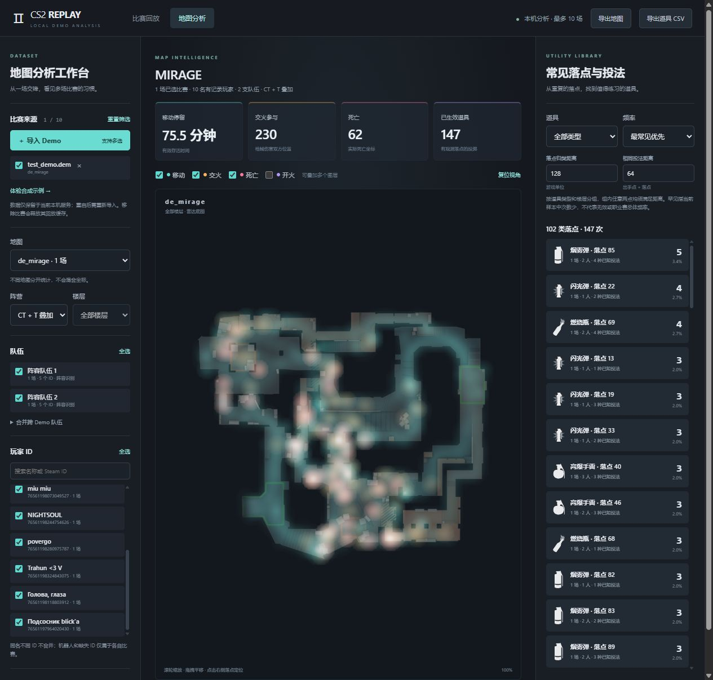

# CS2 Replay — 本地 2D Demo 查看器

将 CS2 `.dem` 比赛录像或包含录像的 `.zip` 放入 `demo` 文件夹及其子文件夹，从 **本地录像库** 选一场回放玩家站位、道具与交锋，或选多场加入 **多 Demo 分析工作台** 汇总热力图与道具投法。支持回合经济、跨 Demo 玩家击杀分析、递归扫描、内容去重和按需解析；v4.1.0 新增死亡扣分与综合影响分，逐次展示计算依据，并提供每回合比较基准。基于 [demoinfocs-golang v5.3.0](https://github.com/markus-wa/demoinfocs-golang/releases/tag/v5.3.0)，网页、地图和解析器均在本机运行，不需要账号、CS2 客户端、REA 或云端服务。


## 启动

**直接使用 Windows x64 便携版：** 从 [Releases](https://github.com/boshgg/cs2-demo-viewer/releases/latest) 下载 `windows-amd64.zip`，完整解压后双击 **`Start Viewer.cmd`**，无需安装 Go 或 Node.js。GitHub 自动生成的 `Source code` 压缩包是源码，不包含可执行文件。

**原目录升级：** 关闭该目录正在运行的程序，替换 `bin/cs2-viewer.exe` 与说明文件，保留 `demo`、`data` 和自己的端口启动参数。`demo` 放原始录像；`data` 保存已解析的比赛库，重启时直接恢复。从 v4.0.9 或更早版本升级后，先在原目录启动新版，等待文件夹扫描完成并关闭程序，再重命名整个安装目录。v4.0.10 会把录像来源保存为相对路径，之后整目录移动或改名仍可恢复缓存、分组和原件关联；保持浏览器访问端口不变可继续使用原有筛选偏好。

**从源码构建：** 安装 [Go 1.24 或更高版本](https://go.dev/dl/)，下载或克隆源码后双击 **`Start Viewer.cmd`**。首次启动会编译本地程序，然后打开默认浏览器。也可以先运行 `build.ps1` 编译。

默认地址：<http://127.0.0.1:8765>。保持终端窗口开启；使用 **Ctrl+C** 停止服务。再次启动仅复用同版本查看器；如果旧版占用端口，会提示先关闭旧版，或用 -port 指定其他端口。

源码仓库不包含 `bin/` 中的生成文件。编译一次后，日常播放不需要 Go 或 Node.js，可直接运行：

```powershell
.\bin\cs2-viewer.exe -open
# 端口被其他程序占用时：
.\bin\cs2-viewer.exe -port 8766 -open
```

## 使用

1. 将 `.dem` / `.zip` 放进 `demo` 及任意子文件夹，点击 **本地录像库**，按名称、文件夹或已知地图查找，选择一场播放。刷新文件夹可发现新加入的录像；也可继续手动导入或拖入 `.dem`。网页直接上传压缩包仍需先解压，其他格式如 `.bz2` 需自行解压。
2. 仅所选比赛进入解析，完成后地图上显示双方玩家位置；有缓存则直接载入。切换录像或停止等待不会删除资料库中的共享记录。
3. 点击播放按钮，或按 **空格** 播放 / 暂停。
4. 选择 **0.25×、0.5×、1×、2×、4×、8×** 倍速。
5. 拖动全场或**本回合进度**跳转；**← / →** 前后移动 5 秒。
6. 点击底部回合条直接切换回合，也可从下拉菜单选择或用上一回合 / 下一回合按钮切换。
7. 使用**跳过冻结**进入回合交战阶段；勾选**循环本回合**反复观察同一段攻防。
8. 在地图上滚轮缩放、拖拽平移，或使用 **− / ＋** 按钮。点击缩放百分比复位；**专注地图**收起侧栏，扩大地图区域。
9. 从地图设置调整**人物大小**；点击地图玩家或两侧队员名单查看装备和个人道具。多人靠近时先放大地图，再用名称和高亮定位各自的真实站位。
10. 地图设置可分别开关名称、当前手持装备图标、开火特效、近 3 秒移动轨迹、道具、抛物线、爆点 / 范围与击杀连线。多层地图可手动切换底图，另一层玩家会淡化显示。

网页里的“体验示例”是**人工合成数据**，仅用于熟悉操作。它包含 3 回合、每回合 5 次击杀，以及烟雾弹、闪光弹、高爆手雷、燃烧弹和诱饵弹；第一回合 7–11 秒演示燃烧，11 秒烟雾生效并灭火，方便检查前后拖动。玩家路线、轨迹、火焰位置均非真实比赛数据。正式复盘请导入自己的 Demo。

## 自定义文件夹分类（v4.0.10）

在安装目录的 `demo` 中创建自己的文件夹，例如 `我的天梯`、`赛事/小组赛`，放入 `.dem` 或 `.zip` 后点击 **刷新文件夹**。回放本地录像库、地图分析的比赛来源与录像库，以及单场 / 跨 Demo 数据分析均提供 **显示全部 / 按文件夹分类**，分类模式还可选择一个文件夹。文件夹筛选与地图、搜索条件一起生效，视图偏好会记住。

子文件夹显示完整相对路径，根目录文件单独归入 `demo 根目录`；ZIP 按压缩包所在的物理文件夹分类，包内路径仍显示在来源说明中。只有缓存或源文件缺失的记录单列。相同内容位于多个文件夹时可在多组看到，但仍是同一个比赛 ID，勾选联动、统计去重。切换分类只改变列表显示，不清除已选比赛、队伍或玩家。

**文件夹批量选择（v4.0.11）：** 地图分析的已导入来源、本地录像库弹层和跨 Demo 玩家分析中，每个文件夹标题旁都有 **全选 / 清空 / 反选**。这些按钮作用于该文件夹的全部录像，包括被地图或搜索隐藏的同文件夹记录；其他文件夹独有录像的勾选保持不变，已导入来源仅调整已载入的比赛。同一比赛同时出现在多个文件夹时，勾选联动且只反选一次，不会重复统计。标题显示文件夹范围和当前显示数量；页面顶部的“全选可见”等操作仍只影响当前列表。选择完成后点击“加入分析”或“分析所选比赛”处理所选录像，批量勾选本身不会解析新文件。

**折叠与展开（v4.0.12）：** 在“按文件夹分类”模式中，点击文件夹标题可单独折叠或展开，也可使用“全部折叠 / 全部展开”。回放录像库、地图分析来源与录像库、单场数据分析和跨 Demo 分析分别记住自己的状态；搜索、地图切换、刷新以及重新打开页面不会清除折叠偏好。折叠仅隐藏组内录像，数量、勾选、分析范围和已载入结果均不变；文件夹批量选择按钮仍可使用，全选或反选会包含折叠的录像。全部折叠后新发现的文件夹也默认折叠，可以再单独展开。

## 多 Demo 分析（v4.0）



从回放页进入 **多 Demo 分析**，或打开 `/analysis.html`。将 `.dem` 或包含 `.dem` 的 `.zip` 放到安装目录的 `demo` 文件夹或其任意子文件夹，启动时自动扫描；网页打开后点击 **刷新文件夹** 更新录像库。扫描只发现、校验并去重，**不会自动解析所有比赛**。在本地录像库中勾选需要的录像并加入分析，才会按顺序解析所选比赛；已有回放缓存直接复用。旧版已加入分析的比赛继续保留。

支持读取 ZIP 内一个或多个 `.dem`，包括 ZIP 内子目录中的录像；只提取录像，不执行包内其他文件。提取数据放在应用的私有缓存目录，不覆盖原始文件。不同子文件夹、不同 ZIP 或原始 `.dem` 中的相同内容按校验去重；同名但内容不同的录像不会误合并。递归扫描所有普通子文件夹，跳过文件链接及缓存目录，不展开 ZIP 内的嵌套压缩包。首次去重需要读取文件内容并校验 ZIP，这与解析比赛事件分开进行；未选比赛不会生成回放或热力图缓存。`.bz2` 等其他格式仍需自行解压；网页手动上传入口接受 `.dem`。

分析库不设 10 场数量上限，不与普通回放的记录互相淘汰。也可继续多选文件手动导入，相同内容会复用已有录像。解析结果保存在安装目录 `data` 中，刷新页面及重启程序均可恢复。移除分析记录仅退出分析，保留原文件与回放缓存，可从录像库再次加入。队伍别名、玩家和比赛勾选、CT/T、地图、图层和色阶等筛选保存在当前浏览器中。

- **地图分组：** 选择地图后，上方比赛来源只显示该地图的录像，并显示本图数量与资料库总数；切换地图不会删除或取消其他地图的比赛选择。尚未识别地图的解析任务、失败任务单独列出，识别完成后自动归入对应地图。每次只分析一张地图，不同地图不会叠到同一坐标系；多层地图可筛选上层、下层或全部。
- **玩家与队伍：** 按 SteamID64 合并跨 Demo 的同一玩家，名称只用作显示；机器人和无稳定 ID 的玩家按录像隔离。队伍优先使用真实队名；通用 CT/T 名称不会被当成同一战队，缺失队名时使用阵容 ID。换边保留队伍身份，同时按事件发生时的 CT/T 侧别归类。队名变体或不同阵容可在工作台明确设置相同队伍别名后合并。
- **热力图叠加：** 移动、交火、死亡及开火图层分别支持 CT、T 或双侧；玩家、队伍和比赛均可多选，选择全部即可观察整张地图在当前样本中的打法。蓝→青→绿→黄→红表示密度从低到高；默认「低频增强」拉开稀少记录的色差，也可切换线性色阶。图例和悬停数值显示相对当前筛选峰值的扩散后密度，非事件占比。各图层独立归一化，叠加取各位置最高相对密度，不混色变白；不同筛选的颜色不能直接比较，原始秒数与次数仍保留在上方统计中。导出地图包含同一色阶与百分比图例。
- **批量筛选：** 队伍与玩家都支持全选、清空、反选。玩家按队伍分组，每组可全选或反选全部队员；“清空”后点某队“全选”即可只勾选该队。同一玩家 ID 在各组联动，搜索支持名称、Steam ID 与队名。批量操作包含搜索隐藏的队员；队伍和玩家筛选同时生效。
- **可调左栏：** 拖动左栏右边界改变宽度，拖动队伍/玩家列表底部改变高度，尺寸在本机记忆。拖柄支持方向键，Shift 加快调整；双击或 Enter 恢复默认尺寸。窄屏禁用宽度拖拽。
- **天梯与多地图：** 没有队名的 Demo 按实际阵容显示为“阵容队伍”，换边后身份保持。每批导入后自动切到首场成功录像的地图，清除旧队伍、玩家与搜索限制；每场旁的“查看”也可跳转地图。服务器重启后不再让过期的 Demo 选择隐藏新数据。
- **移动：** 对存活且连接中的玩家按实际观测时长累计，排除冻结、回合结束后及死亡后的时间。相邻帧最多贡献 0.25 秒，防止录像断档放大停留。地图使用 64 个世界单位的网格汇总；它反映停留密度及常见通行区域，不代表完整路径重建。
- **交火：** 使用实际敌对枪械伤害的双方位置（包括护甲吸收的命中），每名玩家、每个空间格、每回合相对 1 秒窗口最多计一次。它是“交火参与次数”，双方合计会包含同一交锋的两名参与者；未命中的开枪、友伤、投掷物和刀伤不混入这层。
- **死亡：** 使用实际死亡事件的受害者位置，每次死亡计一次，包含自杀和环境死亡，排除冻结及回合结束后。
- **道具落点与投法：** 同类型、同楼层的已观测生效点按距离归为落点区域（默认 128 世界单位）；区域内出手点和生效点均相近的投掷再归为同一投法（默认 64 世界单位）。距离阈值可调，组内两两距离必须满足阈值，避免一串相邻点把两个远处爆点连成一组。未知出手点单独标注，不凭落点猜测投法。
- **常见 / 低频道具：** 展示区域及投法的使用次数、在当前筛选的已观测道具中的占比、涉及玩家和比赛；可查看代表投掷的真实记录轨迹并跳到对应回放。低频仅指当前导入样本中的低频，不代表整个游戏社区的稀有程度。截断录像缺失生效点的道具不参与落点统计。
- **道具出手时段：** 从冻结时间结束、正式开打开始计时，按出手时间分为 `0 ≤ 秒数 ≤ 5`、`5 < 秒数 ≤ 20`、`20 < 秒数 ≤ 50`、`秒数 > 50` 四段。正好 5、20、50 秒归入前一段，范围互不重复；缺少出手事件或可靠开打时刻时单独归为“时间未知”，不会用爆点时间代替。右侧分布显示当前地图、比赛、队伍、玩家、阵营、楼层及道具类型下各时段的数量，点击时段或使用下拉框即可筛选。落点分组、投法、次数、占比与道具 CSV 跟随筛选，其他热力图指标不受道具时段影响；时间选择会在本机保存。

旧道具摘要首次读取时，会利用已有回放缓存自动补充出手相对时间，不需要重新解析原始 Demo；比赛 ID、队伍分组和原有筛选不变。如果回放缓存损坏或缺失，保留原摘要并明确标记时间未知，仍可使用原有道具统计。

分析摘要在本机后端生成；浏览器无需同时加载全部完整逐帧数据，聚合和道具分组使用独立 Worker。支持导出当前地图 PNG 和道具统计 CSV。示例始终标注为合成数据。

## 回合经济与击杀数据分析

### 死亡与综合影响（v4.1.0）

单场与跨 Demo 玩家模式均增加击杀贡献、死亡扣分、累计综合分和每回合综合分。原击杀净值和“特了几个”保持独立。新模型给同档枪械击杀基础贡献，死亡根据首死、枪械档差、死亡前双方人数（含本人）、此前击杀数和回合胜负联合加权；下一连续回合枪械降档或同档/更好枪械下道具减少，最多增加基础死亡扣分的 20%。逐次死亡可展开查看每个系数、次回合比较原因和回放链接。

v4.1.1 的逐次死亡列表支持“扣分最多优先”排序，以及“只看首死”“只看输局死亡”组合筛选。高扣分（例如 −10,000）排在低扣分（例如 −1,000）之前，未计分记录放在最后。这些控件仅改变死亡明细的显示和分页，不改变综合分、玩家排名或原有分析范围。

跨场比较以每个玩家实际有效回合数归一化。0 是模型收支线；每回合 ≥500 暂定优秀、200–499 良好、0–199 轻度正向、−300 至 0 之间负向、≤−300 明显负向。少于 30 个有效回合或证据覆盖不足时不作正式评级。参考线未经竞技总体数据校准，分数不是胜率或玩家真实实力结论。

胜负确定后追杀不加入新综合分，旧击杀净值保持原范围。次回合装备变化是关联，不证明死亡导致的购买损失；道具数量是开局携带数。完整公式、示例和边界见 [综合影响分口径](docs/IMPACT_SCORING.md)。已有回放缓存自动派生新版报告，保留录像 ID、缓存、队伍分组和筛选，不自动重解析全库。

打开 **数据分析**（`/statistics.html`），从本地录像库选择一场比赛。未解析录像只在选中后处理，已有缓存直接读取。支持按队伍、玩家、CT/T、半场和回合筛选，显示逐次击杀、每回合、阵营、阶段及全场累计净值，并可跳回对应时刻的 2D 回放。

### 跨 Demo 玩家分析

切换到 **跨 Demo 玩家**，在左侧勾选多场比赛后点击 **分析所选比赛**。选择具体地图只分析该地图，选择 **全部地图** 可跨图汇总。已有缓存直接读取，尚未解析的录像只在选中并开始分析后处理；没有新的场数上限。

候选玩家只包含在当前比赛与地图范围中至少出现 **2 场不同 Demo** 的有效 Steam ID。一次比赛里的多次击杀不会增加出场次数；同一 ID 改名仍合并，同名不同 ID、机器人与无法稳定识别的身份不会合并为共同玩家。可搜索名字或 ID，勾选一人或多人，并使用全选、清空及反选。

跨场结果只汇总所选重复玩家的击杀行为，保留净值、击杀数、死亡数、“特了几个”、武器对位、各比赛、地图及 CT/T 分项。对手不必也是重复玩家；死亡按所选玩家作为受害者统计。继续使用逐次击杀的最终加权分数，不会再次叠乘。逐次记录显示来源比赛、地图、回合和时间，回放链接定位到对应录像，符合“特了几个”的记录仍用金色边框标记。

切换地图或比赛会重新判断重复出现资格，CT/T 筛选不会改变候选玩家是否达到两场的资格。没有重复玩家时显示原因，不会退回成全队统计。读取失败的比赛单独列出，结果仅基于成功读取的比赛。跨场选择单独保存在浏览器中，不改动地图热力图的队伍分组和筛选。

### 单场经济与计分口径

经济以 **冻结时间结束时持有的装备和剩余金钱** 判断，保枪也计入；五人队“大多数”指至少三人。展示每个人的枪械、护甲、道具和现金，以及主分类、同时命中的规则和判定理由：

| 类别 | 判定口径 |
| --- | --- |
| 手枪局 | 上下半场首回合；加时首回合不自动算手枪局。 |
| 全起局 | 全员有甲，持冲锋枪或长枪，道具尽可能齐全，余钱不影响判定。 |
| 全起有狙局 | 同全起，并有狙击手；狙击手的道具数量不影响判定。 |
| 英雄枪局 | 多数人处于 ECO、余钱超过 1000，少数人持长枪或狙击枪且有甲。 |
| ECO 局 | 轻武器配置，可有甲或无甲，多数人余钱超过 1000。 |
| 强起局 | 可有甲或无甲，购买枪械后多数人余钱不超过 500。 |
| 混起局 | 全员有甲与枪械，道具未全部满配，多数人余钱不超过 1000。 |
| 乱买局 | 至少两人在 ECO，而其余人选择投入装备，呈现不同的经济策略。 |

道具尽可能齐全指已持有四颗，或余钱不足购买任何仍可携带的道具。默认采用标准价格和携带限制（含诱饵 50、闪光 200、烟与高爆 300、燃烧瓶 400、CT 燃烧弹 500）；自定义服务器价格可能影响分类。规则有重叠，界面保留重叠结果供核对；资料缺失不会伪装成完整五人装备。

**基础击杀净值 = 受害者当时手持枪械分值 − 实际击杀枪械分值**。手枪 1、冲锋枪 2、长枪/霰弹枪/机枪 5、狙击枪 7。武器档位从低到高为手枪、冲锋枪、长枪、狙击枪；基础净值为正时，最终净值乘以“档位差 + 1”：相邻档乘 2，跨两档乘 3，跨三档乘 4。手枪杀狙为 `+6 × 4 = +24`，长枪杀狙为 `+2 × 2 = +4`，冲锋枪杀狙为 `+5 × 3 = +15`。自 v4.1.3 起，高级武器杀任何低级武器，仅当击杀者在同回合有有效死亡记录时保留原负净值，否则为 `0`；同档也为 `0`（仍算已计分）。例如长枪杀冲锋枪后当回合死亡为 `−3`，存活为 `0`；狙击枪杀长枪后当回合死亡为 `−2`，存活为 `0`。刀、电击枪、道具击杀，以及受害者手持刀或道具的情况不计分；友军、自杀、环境死亡和武器缺失保留记录与排除原因。逐次明细列出基础净值、倍数、同回合死亡判断与最终净值，全部累计均为最终净值求和，不是通用竞技评分。

**“特了几个”**单独统计有效击杀中，用冲锋枪（2）或长枪（5）杀死当时手持手枪（1）的对手次数。霰弹枪、机枪归长枪；狙击枪杀手枪不计入这个次数，但同样适用上述优势击杀的死亡条件。次数与金色边框不受最终净值为 `0` 或负数影响。顶部卡片与玩家、回合、阵营、半场表继续显示次数，并随队伍、玩家、CT/T、阶段和回合筛选更新。死亡条件从完整比赛的同一玩家 ID、同一回合判断，不受当前明细筛选影响；有效区间内的世界伤害、自杀、队友误杀和胜负确定后的死亡也算，下一回合死亡不算。缺失死亡证据按 `0` 并说明，不伪装成已确认存活。独立死亡影响模块的惩罚公式保持不变。统计报告自动从已有回放缓存更新，不需要重新解析 Demo。

新解析会记录冻结结束的装备快照及死亡时手持武器；死亡事件清空武器时，仅使用同回合最近活 tick 的观测并标记推断。旧缓存无需重新导入，可以使用同回合邻近采样计算，但会明确标记“采样推断”。缺失或过旧的武器记录不强行计分。旧缓存的半场信息优先按阵容换边识别，缺失时采用明确标记的 MR12 推断；新录像优先使用服务器回合参数。

### 更新旧缓存

在地图分析页点击 **重新解析已导入**，会依次更新所有已加入分析且已完成解析的比赛，包含当前地图与筛选隐藏的比赛。数据分析页也可 **重新解析当前比赛**，或更新录像库中全部已解析录像。仅扫描发现、尚未选择的录像不会被批量解析。

重新解析沿用原比赛 ID 和队伍身份，保留队伍分组、比赛/玩家/阵营筛选；当前页面的新结果会自动更新。原回放和热力图在后台处理期间仍能使用，只有新的回放与分析摘要都写入成功才切换缓存。原文件缺失、解析失败或程序中断时保留旧结果，并显示原因，之后可以重试。重复点击同一进行中的任务不会重复排队。

需要原始 `.dem` 或包含它的 `.zip` 仍在 `demo` 文件夹及子文件夹中。如果旧记录只剩缓存，请把同一原始文件放回 `demo` 并刷新文件夹，再重新解析；无需删除比赛。旧版手动上传的临时原件可能已清理，此时也需放回原文件。重新解析能补充新版支持的事件字段，但录像本身缺失的观测仍会标注未知或近似，不会伪造精确数据。

## 回合、道具与玩家复盘

- **回合复盘**保留本回合全部击杀，不再只显示最后四条。尚未发生的事件淡化显示；点击事件可跳转查看。记录包括双方玩家、武器、爆头，以及 Demo 提供的助攻、穿烟、穿墙、盲狙等信息。
- **道具**标签页显示投掷者、道具类型、投出与生效时间，关联地图上的轨迹和爆点。可用类型筛选聚焦烟、闪、雷、火或诱饵；地图和本回合时间轴帮助比较道具与交锋的先后顺序。
- **玩家详情**与队员名单展示血量、护甲、头盔、拆包钳、当前武器、弹药、金钱及剩余道具；闪白、开镜、蹲下等状态来自录像数据。投掷后库存随时间更新。
- **观战布局**将地图放在中央、双方队员放在两侧、回合与控制放到底部。两侧显示主副武器、当前装备高亮、护甲与道具剪影；地图玩家上方显示正在手持的武器，死亡后在实际死亡位置保留灰色姓名与叉号。队伍有记录时显示实际队名。
- **开火特效**依据 Demo 中逐次 `WeaponFire` 的时刻、坐标和朝向绘制枪口火光；使用枪械事件独立记录，不会把手雷投掷或挥刀显示成开枪。高倍速时短暂特效可能跨帧跳过。
- **道具特效**区分烟团与剩余时间弧、火焰、闪光星芒、高爆爆炸和诱饵声波；飞行中的投掷物显示真实装备剪影。所有图标离线打包，来源与许可见 [ICON_SOURCES.md](ICON_SOURCES.md)。
- 道具飞行时显示路径，落地后收起旧轨迹以保持地图清晰；点击道具或在复盘列表定位，可重新查看完整投掷路径与反弹点。
- 地图缩放保持真实位置坐标，不会为了避开重叠而挪动玩家位置。标记大小可独立调整，名称标签与选中高亮用于辨认密集站位。
- **密集站位**中，姓名、编号与手持枪械作为一个整体标签避让，带引线连接实际坐标；标签不会因候选位置用完而直接消失，并尽量沿用上一帧位置避免跳动。标签编号对应左右队员名单，悬停或点击可高亮真实位置。多人靠近时只缩小圆点外观，坐标、相互距离和朝向不变；位置完全重合时可以逐个选择标签，并用滚轮放大查看。

交互功能参考 Noesis 的公开说明：[道具列表、投掷者与事件跳转](https://www.noesis.gg/news/20190129-grenades.html)、[CS2 道具轨迹与烟雾灭火](https://www.noesis.gg/news/october-2023-changelog.html)。第三版布局与表现参考用户提供的 [TGPRO Demo Viewer](https://tgpro.net/demo-viewer) 截图，未使用其专有素材或服务。

## 地图与显示范围

内置 Mirage、Inferno、Dust II、Nuke、Ancient、Anubis、Vertigo、Overpass、Train 九张地图，包含 Nuke / Vertigo / Train 下层图片。地图图片及坐标来自同一版本的 Awpy 数据包，详见 [MAP_SOURCES.md](MAP_SOURCES.md)。

不在列表内的地图仍可解析，但以玩家坐标网格显示。历史 Demo 与现有地图版本可能存在位置偏差；雷达图不会自动按历史游戏版本更换。

道具飞行轨迹、爆点、投掷者和生命周期来自 Demo 解析事件及实体。烟雾消散依据结束事件，燃烧结束（包括被烟扑灭）依据实际燃烧点熄灭，避免把延迟销毁的实体当作仍在燃烧，前后跳转按当前时刻重新绘制。截断或不完整录像若没有效果结束事件，会使用有上限的估计时长，并在解析数据中标记为近似；不会把估计结束当作观测事件。

**效果区域是辅助读图，不是完整 CS2 物理模拟：**烟团使用爆点周围的近似范围，不重建体积烟的实际轮廓、遮挡或被子弹 / 手雷打散的形变；火焰在录像可提供时使用真实燃烧点，但每个点周围的绘制面积仍是示意；闪光星芒和手雷爆炸用于标识生效位置，不代表精确致盲或伤害半径。开火闪光不表示命中，击杀连线连接击杀双方坐标，不代表逐发弹道或穿墙路径。未观测到的飞行路径不会生成模拟轨迹；燃烧实体与投掷物按投掷者、时间及位置关联，来源不全时保留未知类型。回合倒计时读取录像的实际时限；未知时限时显示已进行时间，下包后显示已下包时间，不推测 C4 引爆倒计时。

此工具不模拟完整 3D 视野或声音。热身阶段跳过；个人视角（POV）Demo 可能缺少未被该客户端记录的玩家信息。旧缓存没有新增字段时需重新导入 Demo；升级后应重新编译并重启服务。

## 文件与性能

- 文件仅传给 `127.0.0.1` 上的本地服务，不上传外网；地图也不需要联网加载。
- 支持单个 `.dem` 最大 **2 GiB**，ZIP 中每个解压后的录像也遵循此限制；按约 **16 帧/秒**采集，浏览器对玩家移动作插值。
- 为避免超长录像占用过多内存，最多 120,000 个采样帧（约 125 分钟）；超限会明确报错。解析时长与内存消耗取决于录像大小和比赛时长。
- 文件夹扫描与解析分开执行，ZIP 提取受控，仅明确选择的录像排队逐个解析；启动、刷新和单纯浏览列表不会启动全库解析。数量不设固定上限，实际容量取决于磁盘与浏览器内存。ZIP 损坏、加密或录像尚未完整写入时显示错误，可完成下载后再次刷新。
- 临时上传副本在解析结束后删除；`demo` 中用户放入的原文件保留。分析记录与压缩回放摘要保存在 `data`，正常退出不会清理；持久录像库不会因为打开其他回放而自动淘汰。
- 可用 `-demo-dir "D:\my-demos" -data-dir "D:\viewer-cache"` 指定录像目录与缓存目录，默认路径按程序安装位置确定，不依赖从哪个工作目录启动。
- 文件损坏、旧版 CS:GO 文件或不兼容的 CS2 更新会显示错误。可识别的截断 Demo 仅播放解析成功的部分并显示提示。

## 开发与重新编译

Go **1.24+**，前端使用原生 HTML/CSS/JavaScript，无 npm 构建步骤。前端与地图通过 `go:embed` 打包进单个可执行文件，修改后必须重新编译并重启。

```powershell
.\build.ps1
# 或使用已经加入 PATH 的 Go
go build -o bin/cs2-viewer.exe .
go test ./...
go vet ./...
```

`build.ps1` 优先使用系统 PATH 中的 Go；若本机已有 `%LOCALAPPDATA%\Programs\cs2-viewer-tools\go` 便携版本，也可作为回退使用。项目不会自动下载或安装 Go。

标签布局、多场聚合、文件夹刷新、筛选恢复及道具聚类测试使用 Node.js 内置测试运行器，无需安装 npm 依赖：

```powershell
node --test tests/*.test.cjs
```

真实 Demo 集成测试可选：

```powershell
$env:CS2_TEST_DEMO = 'C:\path\to\test_demo.dem'
go test ./... -count=1
```

测试样本是 [LaihoE/demoparser 的公开测试录像](https://github.com/LaihoE/demoparser/blob/main/src/parser/test_demo.dem)，SHA-256 为 `84a1a4191302bdd2a3bbb5a727842093744b1fb1a228aeec630369e44b622cb2`。真实集成断言对应这个样本（Mirage、10 回合、73 次击杀）；不随本项目分发该录像。

## 项目结构

- `parser.go`：CS2 解析、时间轴、逐帧采样和回合事件。
- `server.go`：本地导入、异步任务、取消、压缩回放缓存与地图接口。
- `library.go` / `session.go`：目录扫描、解析库持久保存与校验后会话迁移。
- `web/`：浏览器界面、Canvas 渲染、独立标签避让和离线地图/装备图标。
- `analysis.go`：活动时段、跨回合队伍识别、玩家侧别和紧凑热力图摘要。
- `web/analysis*`：多 Demo 分析页面、Worker 聚合与道具分组。
- `parser_test.go` / `server_test.go`：解析和 HTTP 流程测试。
- `tests/labels.test.cjs`：密集、重合、边缘、窄视窗和逐帧稳定性测试。
- `analysis_test.go` / `server_analysis_test.go` / `tests/analysis.test.cjs`：统计口径、身份归属、筛选叠加和道具聚类测试。
- `release.ps1`：从干净的已提交源码生成 Windows x64 便携包与 SHA-256 校验文件。
- `licenses/`：第三方依赖和图标来源许可；游戏资产归属见 `MAP_SOURCES.md`、`ICON_SOURCES.md`。第三方素材不因本项目公开而改变其原有权利归属。
